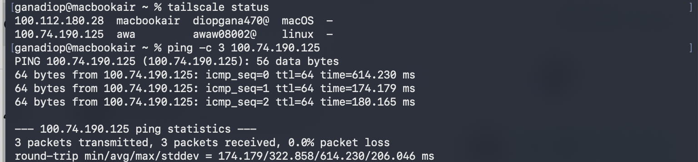
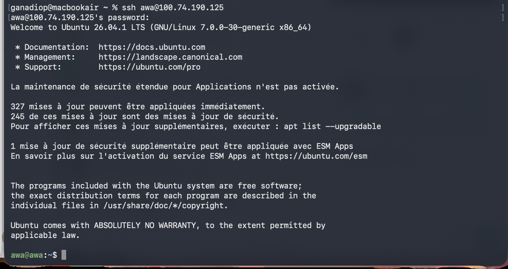
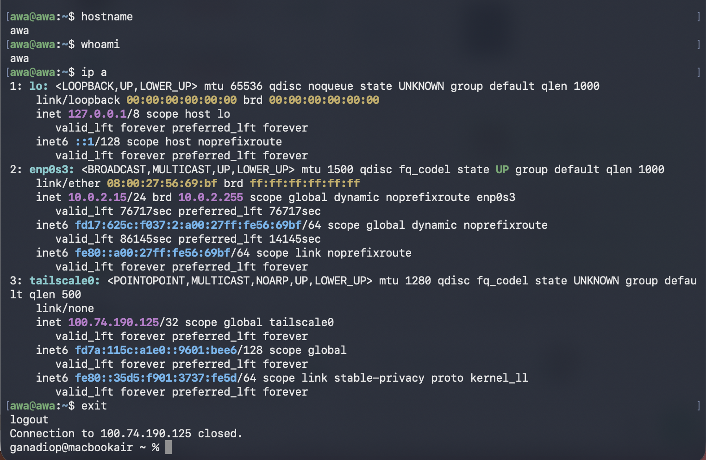
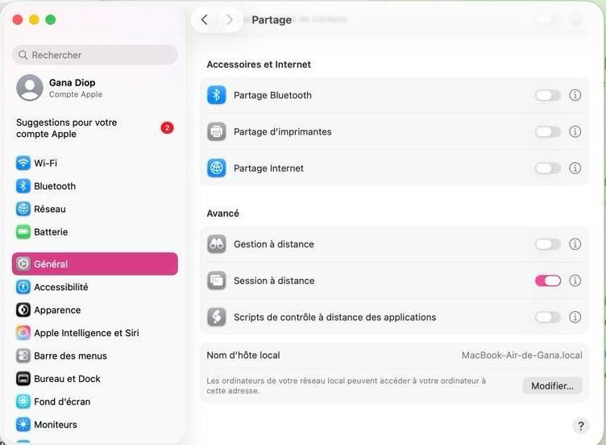
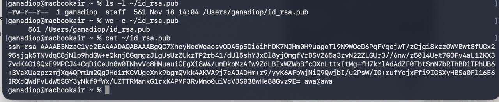
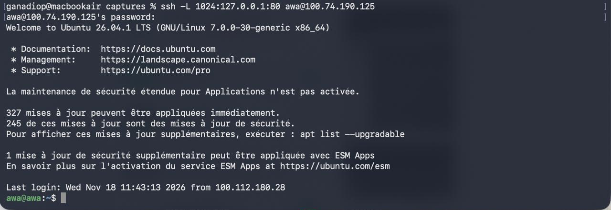
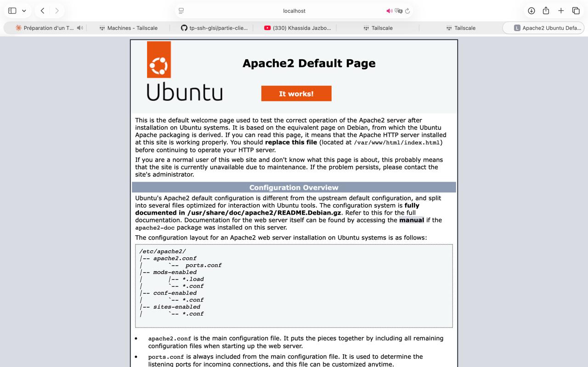
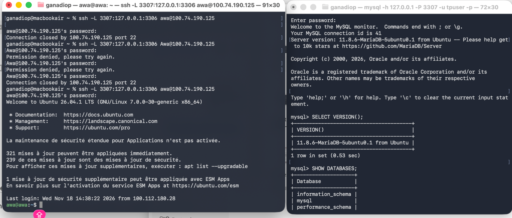
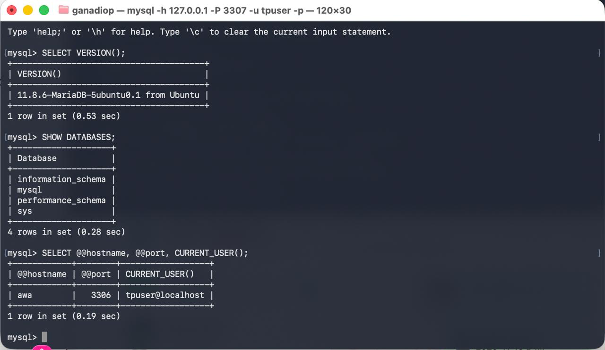

# Partie client (macOS)

**Auteur :** Gana Diop – MacBook Air, macOS
**Serveur du binôme (Awa War) :** Ubuntu 26.04.1 LTS – adresse Tailscale `100.74.190.125`

---

## 1. Réseau privé avec Tailscale

Client et serveur ne sont pas dans le même lieu : les adresses locales (192.168.x.x) ne sont pas joignables entre elles. Nous utilisons **Tailscale** (VPN gratuit), qui donne à chaque machine une adresse privée `100.x.y.z`. Mon Mac a rejoint le réseau Tailscale de ma binôme.

L'application graphique n'a pas démarré sur mon Mac ; j'ai donc installé la version en ligne de commande :

```bash
brew install tailscale
sudo brew services start tailscale
sudo tailscale up
```

Vérification :

```bash
tailscale status
tailscale ip -4
```



---

## 2. Connexion SSH au serveur

```bash
ssh awa@100.74.190.125
```

1. À la première connexion, SSH affiche l'empreinte du serveur ; je réponds `yes`. Elle est enregistrée dans `~/.ssh/known_hosts`.
2. Je saisis le mot de passe du compte `awa`.
3. Le prompt devient `awa@awa:~$` : je suis connecté au serveur.

Vérification :

```bash
hostname
whoami
ip a
```




---

## 3. Clés SSH : réception de la clé publique du serveur

Conformément au sujet, la paire de clés est **générée sur le serveur** (par ma binôme), puis sa **clé publique est envoyée sur ma machine** avec `scp`.

### 3.1 Préparer mon Mac pour recevoir le fichier

`scp` se connecte à mon Mac en SSH : il faut donc activer le serveur SSH de macOS.

**Réglages Système > Général > Partage > Session à distance** (activer).

Je donne ensuite à ma binôme mon nom d'utilisateur (`ganadiop`) et mon adresse Tailscale :

```bash
tailscale ip -4
```

Adresse Tailscale de mon Mac : `100.112.180.28`



### 3.2 Commande exécutée par ma binôme (sur le serveur)

```bash
scp ~/.ssh/id_rsa.pub ganadiop@100.112.180.28:/Users/ganadiop/
```

### 3.3 Vérification chez moi

```bash
ls -l ~/id_rsa.pub
cat ~/id_rsa.pub
```



---

## 4. Tunnel SSH

Principe : un tunnel SSH fait passer un autre protocole (HTTP, MySQL...) à l'intérieur de la connexion SSH chiffrée. Le port local `1024` de mon Mac est relié au port `80` du serveur.

### 4.1 Tunnel web (Apache)

```bash
ssh -L 1024:127.0.0.1:80 awa@100.74.190.125
```

Puis, dans le navigateur : `http://localhost:1024`.




### 4.2 Tunnel base de données (MariaDB)

Terminal 1 :

```bash
ssh -L 3307:127.0.0.1:3306 awa@100.74.190.125
```

Terminal 2 :

```bash
mysql -h 127.0.0.1 -P 3307 -u tpuser -p tpdb
```




---

## Difficultés rencontrées

| Problème | Solution |
|---|---|
| Client et serveur dans des lieux différents | VPN Tailscale |
| L'application Tailscale ne démarrait pas | Installation en ligne de commande avec Homebrew |
| Mon Mac sur son propre réseau Tailscale | Rejoindre le réseau de ma binôme (`tailscale login`, puis approbation de son côté) |
| Mot de passe du compte `awa` refusé | Mot de passe redéfini côté serveur |
| Serveur d'Awa hors ligne sur Tailscale à un moment | Relance du serveur et reconnexion à Tailscale |
| MySQL déjà installé, conflit avec MariaDB | Utilisation du client `mysql` déjà présent |